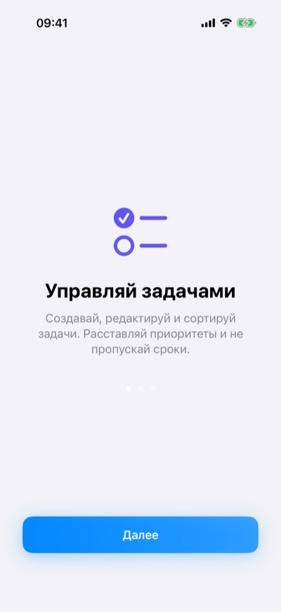
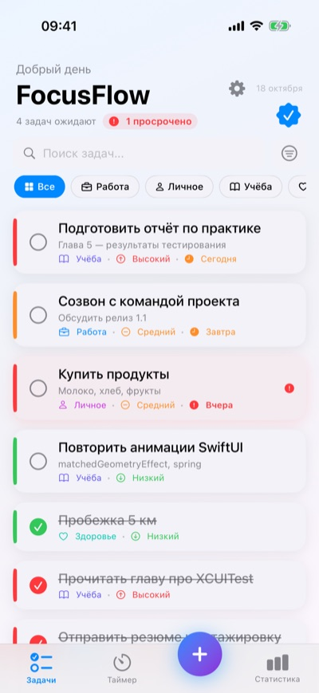
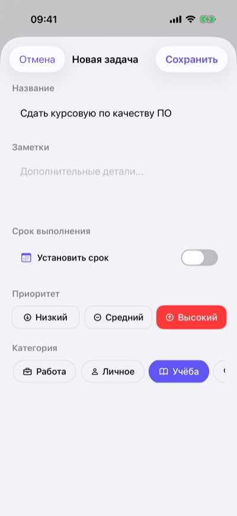
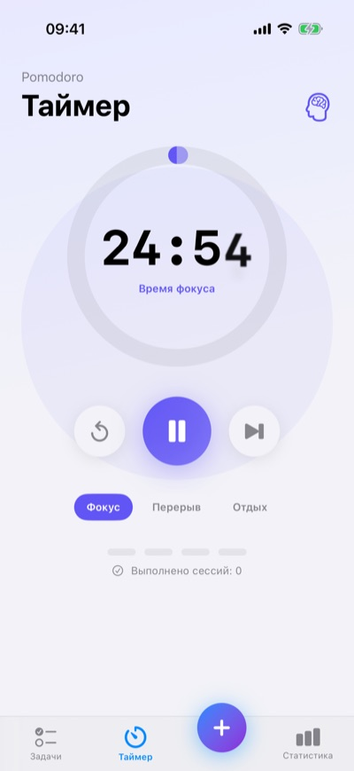
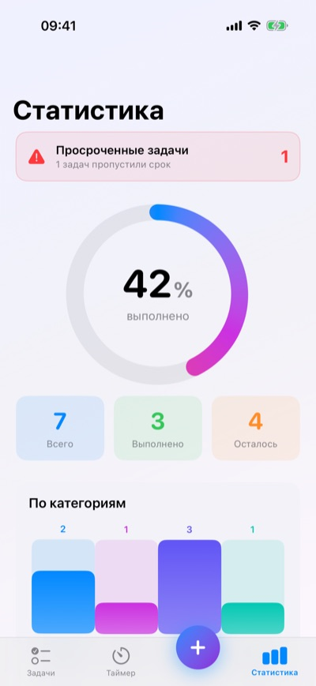
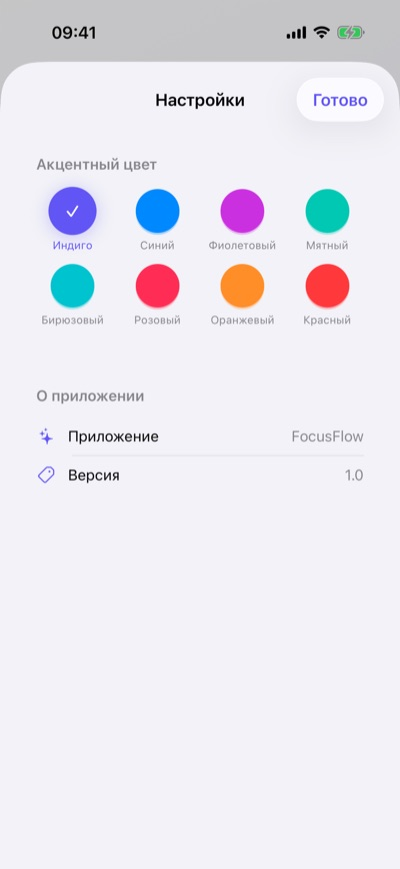

# FocusFlow

A native iOS task manager with a built-in Pomodoro timer, written in SwiftUI.
Tasks have a priority, a category and an optional due date; the app helps you find
what matters (search, filters, sorting, overdue highlighting), focus on it (Pomodoro
timer) and see your progress (statistics screen).

FocusFlow is a course project: it was built in May–June 2026 for a university practice
at SPbGUPTD on the topic *"Methods of evaluating and assuring the quality of mobile
application software"*. The app served as the system under test for an automated
XCUITest suite (see [Testing](#testing)). The user interface is in Russian.

Author: **Begzoda Suhaili Suhrob**

## Screenshots

| Onboarding | Tasks | New task |
|:---:|:---:|:---:|
|  |  |  |
| **Pomodoro timer** | **Statistics** | **Settings** |
|  |  |  |

*Screenshots from the iOS Simulator (iPhone 17 Pro); the tasks shown are demo data.*

## Features

**Tasks**
- Create and edit tasks: title, notes, priority (low / medium / high), category
  (work / personal / study / health) and an optional due date.
- Mark tasks as done with an animated check; delete with a swipe or from the context menu.
- Overdue tasks are highlighted in red, tasks due within a day in orange.

**Finding tasks**
- Search by title and notes.
- Filter by category.
- Sort by date added, priority, due date or title; hide or show completed tasks.

**Pomodoro timer**
- Three modes: focus (25 min), short break (5 min), long break (15 min).
- Animated progress ring and a session counter; when a focus session ends, the timer
  switches to a short break, and to a long break after every fourth session.
- Sound and vibration when a session ends.

**Statistics**
- Completion ring with a 3D tilt (`rotation3DEffect`) and animated counters
  (total / completed / remaining).
- Bar charts by category and by priority, plus an overdue-tasks banner.

**Other**
- Three-page onboarding on first launch.
- Settings: choice of 8 accent colours, applied app-wide.
- Haptic feedback on key actions.
- Data is stored locally on the device; no account, no network, no third-party libraries.

## Testing

The project's main focus is quality assurance. `FocusFlowUITests/FocusFlowUITests.swift`
contains **33 XCUITest UI tests** in six groups:

| Group | Tests | What is checked |
|---|:---:|---|
| Functional | 10 | Adding tasks (title only, all fields, several tasks), toggling completion both ways, swipe-to-delete without affecting other tasks, the statistics tab and its update after adding/completing a task |
| Negative | 5 | Empty and whitespace-only titles keep the form open, Cancel adds nothing, special characters and very long titles are accepted |
| Priorities and categories | 5 | Selecting high/low priority and work/health categories, switching priority from high to low |
| Interface | 5 | Add button and tab bar are present, the form has its required elements, tab switching and repeated opening/closing of the form work without errors |
| Performance | 4 | Main screen appears in under 5 s, the add form opens in under 3 s, adding 10 tasks in a row, data survives an app relaunch |
| Stress | 4 | Rapid repeated taps on "+" open only one form, emoji and Latin titles, a sequence of add → complete → add |

Notes:
- Tests launch the app with the `--uitesting` argument: the app clears stored tasks and
  skips onboarding, so every test starts from a clean state.
- Elements are located through `accessibilityIdentifier`s set in the views.
- In the final practice report all 33 tests passed. The report also includes manual
  profiling in Instruments (launch time about 1.2 s, memory about 48 MB).
- `FocusFlowUITestsLaunchTests.swift` contains Xcode's default launch-screenshot test;
  `FocusFlowTests` holds only the Swift Testing template (no unit tests yet).
- Test configuration lives in `FocusFlow.xctestplan`.

## Tech stack and architecture

- **Swift 5, SwiftUI**, iPhone and iPad targets.
- **MVVM**: `TaskViewModel` (`ObservableObject` with `@Published` properties) owns the
  task list and the search/filter/sort state; views observe it.
- **Persistence**: tasks are encoded to JSON with `Codable` and saved in `UserDefaults`;
  settings (accent colour, onboarding flag) use `@AppStorage`.
- **Haptics and sound**: UIKit feedback generators and AudioToolbox system sounds
  (`Helpers/HapticManager.swift`).
- **Tests**: XCUITest, Swift Testing template, Xcode test plan.
- **Deployment target: iOS 26.5** (as set in the project).

```
FocusFlow/FocusFlow/
├── FocusFlow.xcodeproj
├── FocusFlow.xctestplan
├── FocusFlow/
│   ├── FocusFlowApp.swift        # entry point, onboarding gate, accent colour
│   ├── ContentView.swift         # custom tab bar: Tasks / Timer / Statistics
│   ├── Models/Task.swift         # Task, Priority, Category
│   ├── ViewModels/TaskViewModel.swift
│   ├── Views/                    # task list, card, add/edit form, timer, stats, onboarding, settings
│   └── Helpers/HapticManager.swift
├── FocusFlowTests/               # Swift Testing template
└── FocusFlowUITests/             # 33 XCUITest UI tests + launch test
```

## How to run

Requirements: macOS with an Xcode version that includes the iOS 26.5 SDK or newer
(the build was verified with Xcode 27.1).

1. Clone the repository and open `FocusFlow/FocusFlow/FocusFlow.xcodeproj` in Xcode.
2. Select the **FocusFlow** scheme and an iPhone simulator.
3. Press **Cmd+R** to build and run.

To run on a physical device, select your own development team under
*Signing & Capabilities*.

To run the tests, press **Cmd+U** in Xcode, or from the command line:

```sh
xcodebuild test \
  -project FocusFlow/FocusFlow/FocusFlow.xcodeproj \
  -scheme FocusFlow \
  -destination 'platform=iOS Simulator,name=iPhone 17'
```

Replace the simulator name with one installed on your Mac (`xcrun simctl list devices`).
